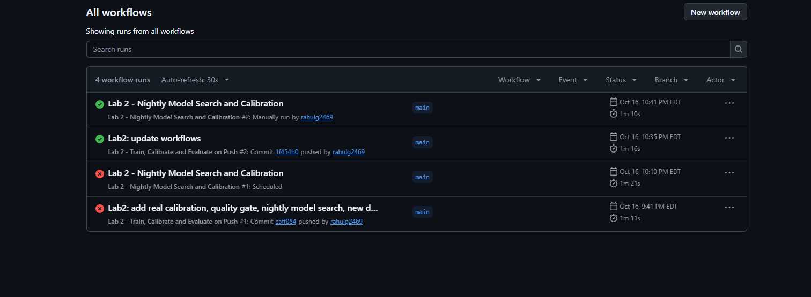
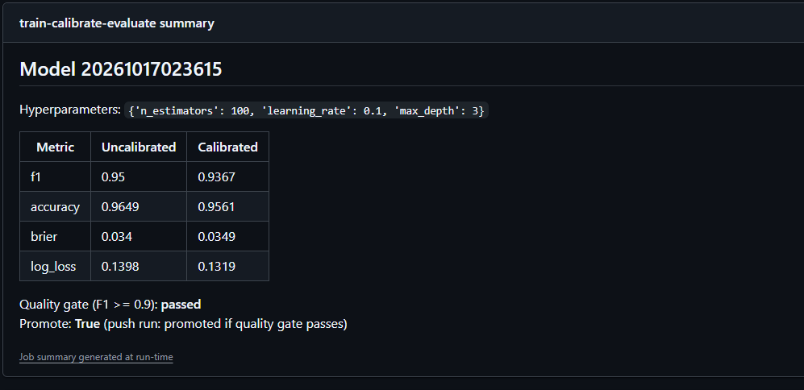
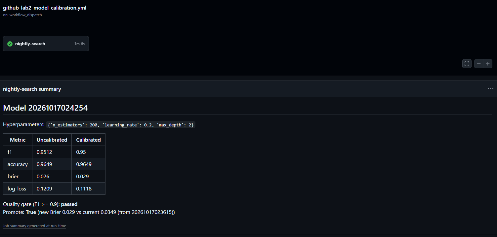
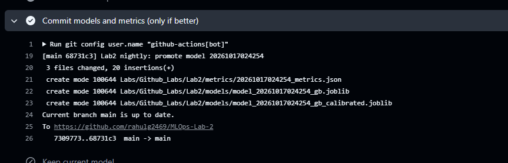

# Lab 2: Model Training, Calibration and Versioning with GitHub Actions

This lab uses GitHub Actions to automatically train, calibrate, test and version a machine learning model every time the code changes, and again every night, with no one running anything by hand.

## What the model does

The model predicts whether a breast tumor is **malignant** (cancerous) or **benign**. Its input is 30 measurements of cell nuclei, such as radius, texture, smoothness and concavity, taken from digitized images of a fine-needle biopsy. The data is the Breast Cancer Wisconsin (Diagnostic) dataset: 569 real tumors, each labeled malignant or benign.

For each tumor, the model outputs a probability, for example "82% chance this is malignant". A tumor is predicted malignant when that probability is 50% or higher.

This is an educational example of an MLOps pipeline, not a medical tool.

## Why calibration matters

In a setting like this, the probability matters as much as the yes/no answer. A doctor might send every tumor above 20% for a follow-up biopsy, so a "20%" needs to mean what it says. Of all the tumors the model rates at 20%, about 20% should actually turn out malignant. A model can be accurate overall and still be overconfident (saying 95% when it is right only 85% of the time) or underconfident.

**Calibration** fixes this. After the model is trained, a small second model (a calibrator) learns how to adjust the probabilities so they match reality. The pipeline measures probability quality with the **Brier score** and **log loss** (lower is better for both), before and after calibration. That way you can see whether calibration actually helped, instead of assuming it did.

## What happens automatically

The 569 tumors are split once, the same way every time:
- 60% for training
- 20% for calibration
- 20% for testing

**When code is pushed**, GitHub Actions:
1. trains a Gradient Boosting model on the training tumors
2. calibrates its probabilities on the calibration tumors, which the model did not train on
3. tests both versions, before and after calibration, on the test tumors, which neither step has seen
4. checks the **quality gate**: if the calibrated model's F1 score is below 0.90, the run fails and the model is thrown away. F1 balances catching malignant tumors against raising false alarms.
5. if the gate passes, it commits the model and its metrics back to this repository, named with a timestamp (e.g. `model_20261017023615_gb.joblib`)

**Every night**, a second workflow tries a new randomly chosen set of model settings (hyperparameters). It goes through the same calibrate and test steps, then compares the result with the current model, which is the most recently committed one. The new model is committed only if its probabilities are better calibrated (lower Brier score); otherwise nothing changes.

The result is that the repository always holds the full history of every accepted model and its scores, and the newest timestamp is the model currently in use.

## The two workflows

There are two workflows. GitHub only runs workflows from the repository root, so the active files are in `.github/workflows/`. Identical copies are kept in `Labs/Github_Labs/Lab2/workflows/` for reference.

**1. On push** (`github_lab2_model_calibration_on_push.yml`)

Runs when code in `Labs/Github_Labs/Lab2/src/`, `requirements.txt`, or the workflow file itself is pushed to `main`. It can also be started by hand.

Train -> Calibrate -> Evaluate + quality gate -> Commit model and metrics

**2. Nightly** (`github_lab2_model_calibration.yml`)

Runs every day at 05:00 UTC, and can also be started by hand. Each night it trains a model with a randomly sampled hyperparameter configuration, calibrates it, and compares it with the current model (the most recently committed one). It commits the new model only if it passes the quality gate and has a lower Brier score. Otherwise it commits nothing.

Train (random config) -> Calibrate -> Evaluate + compare with current model -> Commit only if better

## Dataset and model

- **Dataset:** Breast Cancer Wisconsin (bundled with scikit-learn, so nothing is downloaded). It has 569 samples, 30 numeric features, and binary labels. Labels are flipped so that 1 = malignant.
- **Split:** a fixed 60/20/20 train / calibration / test split (seed 42). Every run is scored on the same test set, so metrics are comparable across runs.
- **Model:** `GradientBoostingClassifier`.
- **Calibration:** `CalibratedClassifierCV` with sigmoid (Platt scaling, the default) or isotonic regression, fit on the calibration split. The trained model only makes predictions on these rows and never learns from them; the calibrator learns from those predictions how to correct the model's probabilities.
- **Metrics:** F1, accuracy, Brier score and log loss, each computed before and after calibration. Brier score and log loss measure how well the probabilities are calibrated; lower is better.

## Changes from the original lab

### Workflow changes

1. **Calibration actually happens now.** The original "calibration" workflows only retrained the model. There is now a dedicated calibration step (`src/calibrate_model.py`).
2. **Quality gate.** If the calibrated model's test F1 falls below a threshold (default 0.90), the run fails and nothing is committed.
3. **The nightly workflow has its own job.** It does a nightly hyperparameter search and promotes a new model only if it beats the current one on Brier score. Previously it duplicated the push workflow, and its commit step used variables that were empty, so it could never commit.
4. **Manual runs with inputs.** Both workflows can be started from the Actions tab (`workflow_dispatch`), with a choice of calibration method (sigmoid / isotonic) and the F1 threshold.
5. **Run summary.** Each run posts a table of metrics before and after calibration, plus the gate and promotion decisions, on the run's summary page.
6. **Path filter on push.** The push workflow only runs when Lab 2 code changes, not on every push to the repo.

### Code changes

- Synthetic `make_classification` data replaced by the Breast Cancer dataset. The original could generate 0 samples and crash, because it used `random.randint(0, 2000)`.
- The model is no longer evaluated on its own training data. There is a proper held-out test set (`src/dataset.py`).
- RandomForest replaced by GradientBoosting, with optional random hyperparameters (`--search-seed`).
- `evaluate_model.py` now writes metrics into `metrics/`. Previously it created the folder but saved the file to the current directory.
- MLflow logging removed. Metrics are tracked in versioned JSON files in the repo and on the Actions summary page.
- Removed unused files: `src/test.ipynb` (leftover Lab 1 notebook) and the `test/` folder (it only held an empty `__init__.py`).
- `requirements.txt`: same packages as the original; scikit-learn now requires 1.6 or newer (needed for `FrozenEstimator`).
- The two Lab 1 test workflows were disabled in this fork's Actions tab, so only Lab 2 runs appear there. One of them is the file `github_lab2_unittest_action.yml`: despite its name, it tests Lab 1 (`Labs/Github_Labs/Lab1/test/test_unittest.py`) and is not part of this lab.


## Running it on GitHub (no local install needed)

You only need a GitHub account.

1. Fork this repository.
2. In the fork, open the **Actions** tab and click "I understand my workflows, go ahead and enable them".
3. Optional: in the left sidebar, disable the two Lab 1 test workflows (open each one, "..." menu, **Disable workflow**) so only Lab 2 runs appear.
4. In the left sidebar, open **Lab 2 - Nightly Model Search and Calibration** and click **Enable workflow**. GitHub disables scheduled workflows in forks by default.
5. Start a run, using either option:
   - Open **Lab 2 - Train, Calibrate and Evaluate on Push**, click **Run workflow**, pick the options, then click **Run workflow** again.
   - Or push any change to a file in `Labs/Github_Labs/Lab2/src/`.
6. Do the same for the nightly workflow to test it without waiting for 05:00 UTC.

### What a successful run looks like

- Every step has a green check.
- The run's **Summary** page shows a table like this (exact numbers vary by run):

  | Metric | Uncalibrated | Calibrated |
  |---|---|---|
  | f1 | 0.95 | 0.9367 |
  | accuracy | 0.9649 | 0.9561 |
  | brier | 0.034 | 0.0349 |
  | log_loss | 0.1398 | 0.1319 |

  followed by `Quality gate (F1 >= 0.9): passed` and the promotion decision.
- A new commit from `github-actions[bot]` appears on `main`. It adds `models/model_<ts>_gb.joblib`, `models/model_<ts>_gb_calibrated.joblib` and `metrics/<ts>_metrics.json` under `Labs/Github_Labs/Lab2/`.
- For the nightly workflow, a green run with "Promote: False" is also a success. It means the new model was not better, so the current model was kept and nothing was committed.

Note: calibration does not always improve every metric. With the default settings it lowers log loss but raises the Brier score slightly, because gradient boosting is already fairly well calibrated and the calibration set is small (114 rows). The pipeline measures this on every run instead of assuming calibration helped.

To see the quality gate fail: run the push workflow by hand with `min_f1` set to `0.99`. The evaluate step fails (red X) and no commit is made.

### Screenshots from this repo's runs

**1. Actions tab: both workflows running successfully**


**2. Push run: metrics before and after calibration, quality gate passed, model committed**


**3. Nightly run: a random config (200 trees, learning rate 0.2, depth 2) beat the current model on Brier score (0.029 vs 0.0349), so it was promoted**


**4. Nightly run: the "only if better" commit step versioned the new model and metrics; "Keep current model" was skipped**


## Running it locally (optional)

**Requirements:**
- Git 2.x
- Python 3.11 (3.10 to 3.12 also work)

On Windows, use Git Bash for the commands below.

```bash
git clone https://github.com/<your-username>/MLOps-Lab-2.git
cd MLOps-Lab-2/Labs/Github_Labs/Lab2

python -m venv .venv
source .venv/bin/activate          # Windows Git Bash: source .venv/Scripts/activate
pip install -r requirements.txt

# Push-workflow equivalent
python src/train_model.py --timestamp 20260101000000
python src/calibrate_model.py --timestamp 20260101000000 --method sigmoid
python src/evaluate_model.py --timestamp 20260101000000 --min-f1 0.90

# Nightly-workflow equivalent
python src/train_model.py --timestamp 20260102000000 --search-seed 20260102000000
python src/calibrate_model.py --timestamp 20260102000000
python src/evaluate_model.py --timestamp 20260102000000 --compare-latest
```

Each command prints what it did. The evaluate step prints the metrics table and the gate and promotion decisions. Models are saved to `models/` and metrics to `metrics/`.

Locally, every run writes a metrics file. In CI, a nightly run that is not promoted is never committed, so the "current model" comparison only sees promoted models.

## License

MIT, as in the original repository.